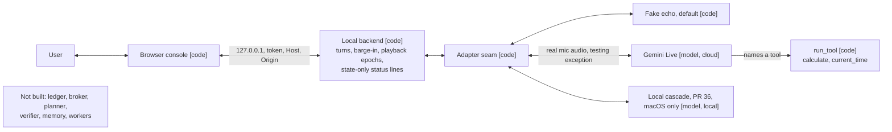
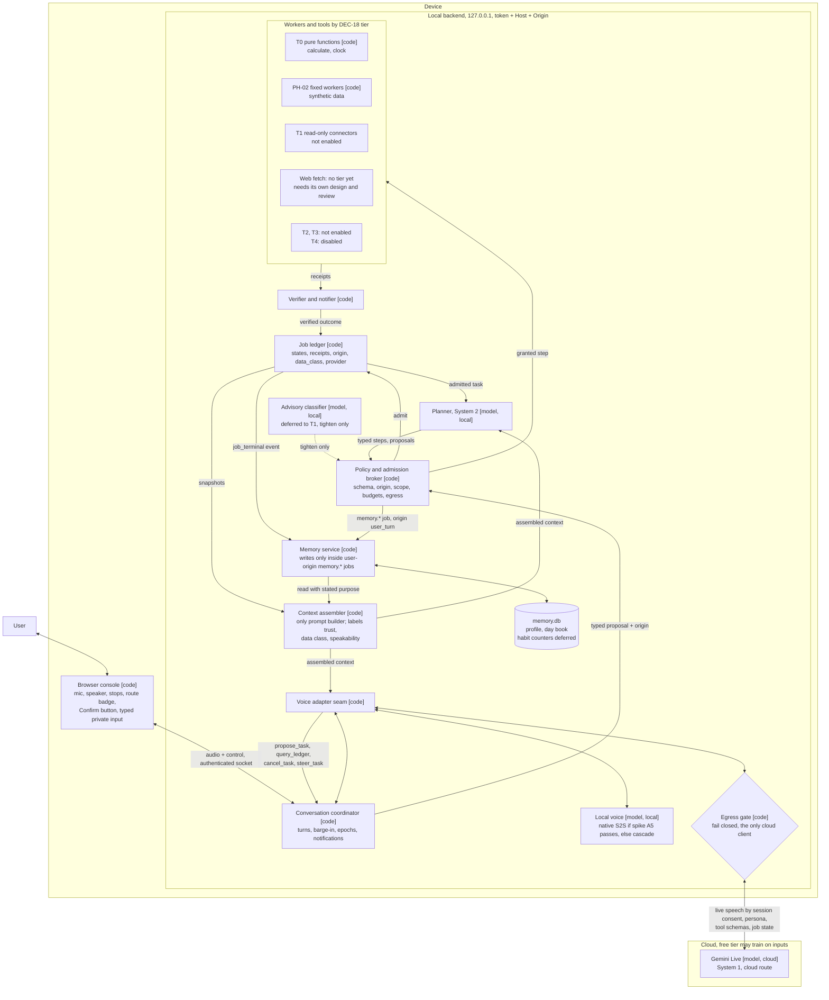

# Target architecture (proposal)

**Proposal. Not approved. Not on the roadmap.**

Date: 2026-11-13. This comes from a draft by `claude-fable-5-2`, revised by a council of four `claude-sonnet-5-5` members. It advises [DEC-20](../../descisions.md#dec-20) and decides nothing. Related: [DEC-07](../../descisions.md#dec-07), [DEC-18](../../descisions.md#dec-18), [session log](../../tasks/logs/2026-11-13-session-log.md). The full draft and verdict text stay outside the repository.

## 1. Today (what runs now)

## 2. Target (proposal)

Rules shown in the diagram:

- Three data classes only: `synthetic`, `live-speech`, `personal`. `personal` is the default and never leaves the device.
- Gemini Live gets no stored memory values and no memory references. It hears only "done" or "failed" for personal jobs. Results go to the screen.
- No model has an edge to `memory.db`. Models read memory only through the context assembler.
- Every model output is a proposal that the broker checks ([DEC-07](../../descisions.md#dec-07)).

## 3. Legend

- `[code]`: deterministic code. `[model, local]`: a model running on the device. `[model, cloud]`: a model at a provider.
- Solid arrow: a code path. Dashed arrow: deferred or advisory.
- The Device and Cloud boxes mark the local and cloud boundary. Only the egress gate crosses it.

## 4. Changes from the operator's PNG

A list to apply to the operator's own drawing:

1. Add the local backend boundary (127.0.0.1, token, Host, Origin).
2. The browser never talks to a model directly.
3. The voice model is System 1 inside the coordinator. Its tools are `propose_task`, `query_ledger`, `cancel_task`, and `steer_task`, not `delegate_task()`.
4. The brain does not write memory. The memory service writes only through broker-admitted, user-origin `memory.*` jobs. Models read memory only through the context assembler.
5. Add the egress gate and the local/cloud boundary.
6. Internet fetch has no tier yet. It needs its own design and security review.
7. Personal apps are gated by DEC-18 tier designs plus security reviews, not just "strong auth".
8. Show data-class routing (`synthetic`, `live-speech`, `personal`).

## 5. Deferred, with the signal to build each

| Item | Build when |
| --- | --- |
| Advisory classifier | T1 brings untrusted text |
| Cloud plan-then-fill | The local planner measurably fails at PH-04 |
| Per-key cloud labels | Someone asks for a stored value to go to the cloud |
| Habit counters and routine keys | After about 3 weeks of day-book data |

## 6. Open points

- The user's spoken audio is itself personal data. The egress gate cannot see it, so "stored memory never leaves" protects little on the cloud route. The cloud route is a two-maintainer decision (OD-1, R-A.2), not a toggle.
- Windows private mode needs a typed-input path. It is not on the roadmap.
- Spike A5 decides the local voice box (native S2S or cascade).
- Everything here is document-only until R-01.4 and R-01.10 close.
