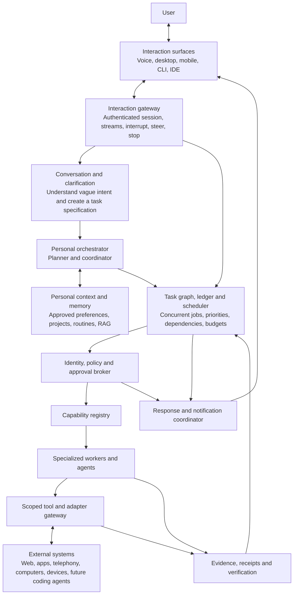
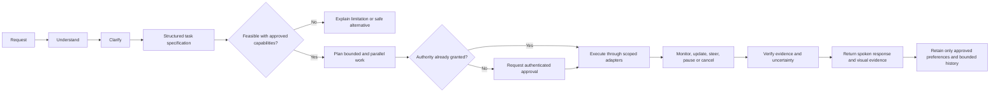

# Personal agent platform architecture proposal

| Field | Value |
| --- | --- |
| Date | 2026-11-08 |
| Status | Brainstorm proposal. Not approved by both maintainers. Closes no runtime gate. |
| Lucidchart source | [Expanded Lucidchart JSON](../References/personal-agent-architecture.json) |
| Original sketch | [User-authored source sketch](../References/projectdiagram.json) |

## North star

A personalized, always-available assistant turns vague everyday intentions
into supervised work across digital services, specialized agents, and future
connected devices. It is voice-first and hands-free when useful, but also
supports visual reports, text, mobile, CLI, and IDE interaction.

The product is general in intent and modular in capability. A first validation
slice does not define its long-term feature boundary. New abilities arrive as
reviewed capability adapters instead of unrestricted model authority.

## Platform view

## Universal task lifecycle

## Architectural responsibilities

### Interaction surfaces

Voice is a primary hands-free interface, not the only interface. Detailed
sources, plans, prices, logs, and approvals can use a screen while the same
job remains controllable by voice.

### Conversation and clarification

The conversation model interprets vague requests and asks only the questions
needed to establish the goal, scope, constraints, depth, deadline, and desired
output. It produces a proposal, not execution authority.

### Personal orchestrator

The orchestrator decomposes work, selects registered capabilities, and creates
a task graph. It may schedule independent work concurrently. The application
ledger, not model narration, owns job truth.

### Identity, policy and approval

Capabilities operate at explicit authority levels:

| Level | Meaning | Example class |
| --- | --- | --- |
| Read | Observe and summarize approved sources. | Search, retrieve, inspect. |
| Prepare | Produce a proposal without external effect. | Draft, itinerary, action preview. |
| Act | Perform a reversible or bounded external action. | Send or modify within a grant. |
| Commit | Spend, accept terms, represent the user, or cause an irreversible effect. | Purchase, contract, destructive operation. |

Voice does not create new authority. Consequential operations require the
authentication and confirmation selected by a separately approved design.

### Capability registry and workers

The registry describes available operations, schemas, recipients, permissions,
health, costs, and limits. Capability families may eventually cover research,
planning, communication, telephony, transactions, computers, devices, and a
developer harness. These are future adapter categories, not implemented tools.

### Tool gateway and external systems

Workers never receive unrestricted internet, personal-application, computer,
or shell access. A scoped gateway validates every request and response, checks
egress and data recipients, and enforces time, rate, size, resource, and budget
limits outside models.

### Evidence and response

Sources, timestamps, receipts, observed outcomes, partial effects, and
uncertainty return to the ledger. Spoken and visual responses report those
facts. Model confidence alone cannot mark a task successful.

## Delivery boundary

This proposal broadens product direction; it does not change the signed design,
PRD, phase statuses, or runtime gates. Coding-agent control remains a future
capability behind a dedicated harness. No shell, telephony, transaction,
personal-app, device, or internet authority is added by this document.
